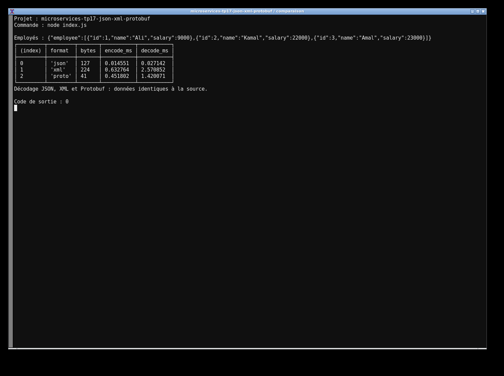
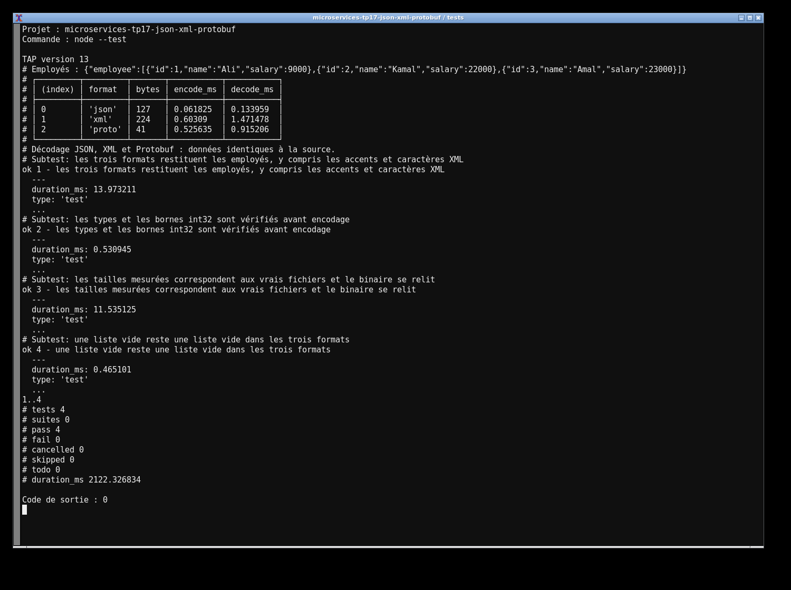

# TP17 — JSON, XML et Protobuf

J'ai sérialisé les trois employés du TP avec JSON, `xml-js` et `protobufjs`. Le schéma est dans `employee.proto`; le programme écrit `data.json`, `data.xml` et le fichier binaire `data.proto`.

Avec Node.js 18 ou supérieur :

```sh
npm ci
npm test
npm start
```

La console affiche les tailles réellement lues sur disque et les temps d'encodage/décodage mesurés sur la machine. Les données décodées sont comparées à l'objet d'origine pour les trois formats. Les tests vérifient aussi les caractères spéciaux, la liste vide et les valeurs invalides.

Les captures viennent des exécutions réelles dans le terminal.



